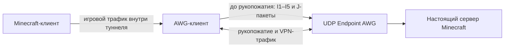

# Mimicry Generator — AmneziaWG × Minecraft

Локальный генератор параметров AmneziaWG и шаблонов начальных UDP-пакетов с
формой Minecraft Bedrock/RakNet. Проект помогает настроить профиль AWG с
подходящими для эксперимента параметрами и посмотреть, какие поля будут
заданы. Он **не создаёт полноценную Minecraft-сессию**, не является VPN-сервером
или клиентом и не гарантирует обход DPI или блокировок.

В браузере генерация выполняется локально: проект не отправляет seed,
параметры или ключи на внешний сервер. CLI также работает локально.

## Как работает профиль

Важно различать три вещи:

1. `Endpoint` — внешний UDP-адрес сервера AmneziaWG. AWG-клиент отправляет туда
   начальные пакеты и устанавливает VPN-туннель.
2. CPS-параметры `I1–I5` и `Jc/Jmin/Jmax` задают форму начальной цепочки UDP-
   пакетов, которую AWG-клиент отправляет перед рукопожатием. В профиле
   Bedrock шаблоны содержат отдельные поля, встречающиеся в RakNet.
3. После установления AWG-туннеля приложения передают данные через VPN.
   Minecraft-клиент подключается к игровому серверу уже обычным для него
   способом через туннель.



Схема не означает, что AWG-сервер отвечает на RakNet-запросы. Генератор не
открывает отдельное соединение с Minecraft для отправки I-пакетов. Например,
поле IPv4 для I3 кодируется **внутри шаблона I3**; само по себе оно не меняет
сетевой маршрут. В JSON это же значение также записывается как адрес peer.
В клиентском `.conf` оставлен плейсхолдер `Endpoint = <SERVER_HOST>:<порт>` —
его необходимо заменить адресом AWG-сервера.

AWG отправляет настроенные I-пакеты в указанном порядке перед каждым
рукопожатием — первым и повторными; затем может отправить junk-пакеты. Они не
повторяются перед каждым игровым пакетом. В AWG 3.1 `RekeyAfterTime` задаёт
временной порог для обновления ключей. При активном туннеле более длинный
интервал может сделать эти цепочки реже, но не отключает их после первого
запуска и не задаёт точное расписание. После рукопожатия передаются пакеты
AWG/WireGuard: настройки размеров, дополнения и заголовков меняют их внешнее
оформление, но не превращают данные туннеля в Minecraft-трафик. Подробнее:
[документация AmneziaWG](https://docs.amnezia.org/documentation/amnezia-wg/) и
[таймеры WireGuard](https://www.wireguard.com/protocol/).

## Что генерирует проект

- Web-интерфейс: клиентский `.conf`, серверный `.conf`, JSON endpoint типа
  `awg`, список параметров и разбор размеров/пакетов.
- Python CLI: те же форматы вывода и проверка внутренних ограничений через
  `--check`.
- Профили `bedrock` и `java`, версии AWG 2.x и 3.x, режимы `fast`, `balanced`
  и `stealth`.
- Воспроизводимые параметры по seed. `HeaderProtectionKey` не выводится из
  seed и по умолчанию генерируется криптографически случайным. В CPS-записях
  `<r N>` AWG также создаёт случайные байты при отправке пакета.

Проект состоит из файлов:

| Файл | Назначение |
|---|---|
| `index.html` | Локальная страница генератора |
| `styles.css` | Стили интерфейса |
| `app.js` | Генератор и web-интерфейс без сторонних библиотек |
| `mimicry.py` | Генератор CLI на Python |
| `test_mimicry.py` | Тесты и сравнение результатов JavaScript/Python |

## Быстрый старт

### Web-интерфейс

Откройте `index.html` в современном браузере. Сборка и установка зависимостей
не нужны. Выберите профиль, версию AWG и режим, задайте параметры и нажмите
«Сгенерировать». Результат доступен на вкладках «Параметры», «Клиент .conf»,
«Сервер .conf», «JSON» и «Пакеты».

### CLI

Требуется Python **3.10 или новее**. Внешние Python-пакеты не нужны.

```sh
python mimicry.py                                  # клиентский .conf в stdout
python mimicry.py --seed demo --format json        # JSON для панели
python mimicry.py --format server --output server.conf
python mimicry.py --seed demo --check              # проверки и ненулевой код при ошибке
python mimicry.py --help                           # все аргументы
```

Основные аргументы:

| Аргумент | Значения / назначение |
|---|---|
| `--profile` | `bedrock` или `java`; по умолчанию `bedrock` |
| `--awg` | `2` или `3` (профиль AWG 3.1); по умолчанию `3` |
| `--mode` | `fast`, `balanced` или `stealth` |
| `--mtu` | MTU от 576 до 1500; по умолчанию 1280 |
| `--ip` | IPv4 peer в JSON и адрес в I3 профиля Bedrock; по умолчанию `192.0.2.1` — документационный адрес |
| `--port` | UDP-порт Endpoint; также включается в поля профиля; 1–65535; по умолчанию 19132 для Bedrock, 25565 для Java |
| `--seed` | Seed для воспроизводимости параметров; без него создаётся случайный seed |
| `--header-key` | `HeaderProtectionKey` AWG 3.x в base64 или hex; используется вместо случайного ключа |
| `--format` | `client`, `server`, `json` или `params` |
| `--output` | Записать выбранный результат в файл |
| `--check` | Проверить ограничения генератора и завершиться с ненулевым кодом при ошибке |

Некорректный IPv4 для CPS I3 заменяется на `192.0.2.1` с предупреждением.
Этот TEST-NET адрес нельзя использовать как реальный адрес VPN-сервера.

## Профиль Bedrock / RakNet

Bedrock традиционно использует RakNet поверх UDP, поэтому профиль формирует
пакеты с отдельными RakNet-полями. Это **начальные шаблоны для CPS**, а не
валидный диалог клиента с игровым сервером. Структура настоящих RakNet-пакетов
описана в [RakNet protocol](https://github.com/GolemOrg/RakNet/blob/master/PROTOCOL.md).

| CPS | Содержимое шаблона | Что важно |
|---|---|---|
| `I1` | ID `0x01`, 8 байт `<r 8>`, RakNet magic, Client GUID | Похоже на `Unconnected Ping`, но 8 байт случайные, а не осмысленное значение поля времени; источники по RakNet трактуют его как uptime клиента или Unix-время |
| `I2` | ID `0x05`, magic, версия `0x0b`, нулевое заполнение | Форма `Open Connection Request 1`; payload настраивается под MTU |
| `I3` | ID `0x07`, magic, IPv4 family, инвертированные октеты IPv4, порт, MTU, тот же GUID | Форма `Open Connection Request 2`; числовые поля порта и MTU кодируются в сетевом порядке байтов |
| `I4` | ID `0x84`, sequence `0`, unreliable frame header, случайный payload | Форма RakNet Frame Set; payload не является данными Minecraft |
| `I5` | ID `0x84`, sequence `1`, unreliable frame header, случайный payload | Ещё один шаблон Frame Set; это не продолжение подтверждённой игровой сессии |

Для `I2` размер UDP-payload вычисляется как `min(1400, max(548, MTU − 28))`.
`28` — размер IPv4 и UDP заголовков. Размер MTU, передаваемый в `I3`, равен
размеру `I2` плюс 28 байт. Поэтому при MTU 1280 I2 занимает 1252 байта, а I3
указывает MTU 1280; при большом заданном MTU Request 1 ограничивается 1400
байтами payload, то есть 1428 байтами вместе с IPv4/UDP. Этот расчёт
использует IPv4-заголовок. Если внешний Endpoint будет достигаться по IPv6,
заголовок IPv6 больше; проверьте фактический путь и MTU.

Цепочка не соответствует полноценному RakNet-handshake: между I1, I2 и I3
нет ожидаемых ответов сервера, а I4/I5 не являются игровыми данными. AWG
endpoint не отправляет RakNet `Unconnected Pong`, `Open Connection Reply 1/2`
или игровые ответы. Указание в I3 Bedrock-порта не превращает VPN endpoint в
сервер Minecraft; если на том же IP и порту уже слушает Minecraft, возможен
конфликт UDP-портов.

Некоторые подключения Bedrock используют NetherNet/WebRTC и HTTP-сигнализацию,
а не RakNet-подключение к серверу. Этот генератор их не имитирует. См.
[NetherNet guide от Mojang](https://github.com/Mojang/bedrock-protocol-docs/blob/main/additional_docs/NetherNetOnboardingGuide.md).

## Профиль Java

Профиль Java формирует поверхностные байтовые сигнатуры старого Server List
Ping, Handshake, Status Request и Status Ping. Java Edition использует TCP, а
AWG — UDP, поэтому эта последовательность не является корректным Java-сеансом
и не маскирует транспорт. I4/I5 в настоящем status-обмене должны следовать за
ответом сервера, которого AWG endpoint не отправляет. Профиль оставлен для
экспериментов с формами байтов, а не как рекомендуемый вариант маскировки.

## Версии AWG

### AWG 2.x

Генерируются `Jc`, `Jmin`, `Jmax`, `S1–S4`, `H1–H4` и `I1–I5`. Для профиля
Bedrock значения H подобраны под направления RakNet-сообщений: `H1 = 5`
(Request 1 клиента), `H2 = 6` (Reply 1 сервера), `H3 = 28` (Unconnected Pong
сервера), `H4 = 128-141` (набор Frame Set ID). Для Java используется отдельный
набор значений: `H1 = 254`, `H2 = 253`, `H3 = 252`, `H4 = 248-251`.
`HeaderProtectionKey` и остальные поля AWG 3.x не добавляются.

### AWG 3.1

Кроме общих параметров, формируются `HeaderProtectionKey`,
`ContentPaddingAddition`, `RandomTrailers`, `DisableCookies` и диапазоны
таймеров. В профиле используются стандартные H1–H4 (`1`, `2`, `3`, `4`) вместе
с Header Protection; ключ — 32 случайных байта, сериализованных в base64.
Ключ должен быть одинаковым на обеих сторонах туннеля. Шаблоны клиента и
сервера, полученные из одного результата генерации, содержат одинаковый ключ;
при независимой генерации ключ будет другим. Seed его не фиксирует. В CLI
можно задать `--header-key` для повторного использования существующего ключа.

`DisableCookies = on` отключает Cookie Reply на стороне, отвечающей на
рукопожатие, и ослабляет защиту от handshake-флуда. Для публичного сервера
оцените этот риск и при необходимости измените параметр на `off`.

## Режимы генерации

Режимы — это пресеты генератора, а не уровни гарантированной скрытности.
Наборы `Jc/Jmin/Jmax` и `ContentPaddingAddition` выбираются в указанных
диапазонах; конкретные значения зависят от seed.

| Режим | `Jc` | `Jmin` | `Jmax` | AWG 3.x `ContentPaddingAddition` | `RandomTrailers` |
|---|---:|---:|---:|---:|---|
| `fast` | 2–4 | 32–64 | 160–400 | 12–64 | `off`; S1–S4 различаются |
| `balanced` | 4–7 | 48–96 | 300–800 | 16–128 | `on`; S1–S4 равны |
| `stealth` | 7–12 | 64–128 | 700–1200 | 32–256 | `on`; S1–S4 равны |

Для AWG 2.x размеры S1–S4 выбираются отдельно:

| Режим | S1 и S2 | S3 | S4 |
|---|---:|---:|---:|
| `fast` | 16–40 | 8–20 | 0–12 |
| `balanced` | 40–88 | 16–44 | 8–24 |
| `stealth` | 72–140 | 24–64 | 20–32 |

Для AWG 3.x в `fast` S1–S4 выбираются разными из диапазона 12–20; в
`balanced` — одним общим значением 16–28, в `stealth` — одним общим значением
24–32. Все эти значения не меньше 12, что требуется Header Protection.
При `RandomTrailers = on` текущая генерация намеренно делает S1–S4 одинаковыми.

Для AWG 3.x также задаются такие диапазоны таймеров:

| Режим | `RekeyAfterTime` | `RekeyTimeout` | `RejectAfterTime` | `KeepaliveTimeout` | `MaxHandshakeAttempts` | `PersistentKeepalive` |
|---|---:|---:|---:|---:|---:|---:|
| `fast` | 120 | 5 | 180 | 10 | 8 | 25 |
| `balanced` | 120–150 | 5–8 | 190–240 | 10–20 | 8–12 | 20–30 |
| `stealth` | 140–180 | 6–10 | 220–280 | 12–25 | 10–16 | 20–30 |

Для AWG 2.x клиентский `PersistentKeepalive` фиксирован на 25.

## Согласование и экспорт

| Параметр | Где требуется одинаковое значение |
|---|---|
| `S1–S4`, `H1–H4` | Клиент и сервер |
| `HeaderProtectionKey`, `RandomTrailers` | Клиент и сервер AWG 3.x |
| `ContentPaddingAddition` | На отправляющей стороне; настройте обе стороны, если требуется для обоих направлений |
| `DisableCookies` | Локальная настройка стороны, отвечающей на handshake; обычно сервер |
| `Jc`, `Jmin`, `Jmax`, `I1–I5` | Клиент; на сервере не нужны |
| Таймеры и `PersistentKeepalive` | Клиентская сторона/конфигурация |

Экспортируемые шаблоны содержат плейсхолдеры ключей (`<PRIVATE_KEY>`,
`<SERVER_PUBLIC_KEY>`, `<PRESHARED_KEY>`, `<CLIENT_PUBLIC_KEY>`). Перед
использованием замените их настоящими значениями и проверьте адреса, маршрут,
DNS, подсети и сетевые правила сервера.

- **Клиентский `.conf`** содержит `Endpoint = <SERVER_HOST>:<порт>`, маршрут
  `AllowedIPs = 0.0.0.0/0, ::/0` и DNS `1.1.1.1`. Так настроен full-tunnel
  шаблон: весь IPv4- и IPv6-трафик направляется через VPN. Если нужен только
  выбранный трафик, настройте `AllowedIPs` под свою схему.
- **Серверный `.conf`** — заготовка с `ListenPort`, адресом туннеля
  `10.8.0.1/24` и peer `10.8.0.2/32`. Она не настраивает самостоятельно
  forwarding, NAT, firewall или выдачу адресов.
- **JSON** — endpoint типа `awg` для импорта в совместимую панель. Перед
  импортом замените плейсхолдеры ключей и проверьте схему панели. В JSON адрес
  peer берётся из IPv4-поля генератора; `persistent_keepalive_interval`
  намеренно не задаётся, чтобы панель могла применить своё значение по умолчанию.
- **`params`** — текстовый список генерируемых параметров.

Пример для профиля Bedrock: AWG-сервер и настоящий Minecraft-сервер не должны
пытаться слушать один и тот же UDP-порт на одном IP. Используйте отдельный IP,
другой порт или подходящую схему NAT/маршрутизации. Порт 19132/19133 типичен
для Bedrock, но сам по себе не делает AWG-пакеты настоящим RakNet-трафиком.

## Воспроизводимость и проверки

При одинаковых профиле, версии AWG, режиме, MTU, адресе, порте и seed
JavaScript- и Python-генераторы должны возвращать одинаковые параметры и
экспортируемые данные. Seed не делает CPS-пакеты побайтно одинаковыми при
каждой отправке: AWG интерпретирует `<r N>` как случайные байты. В AWG 3.x
случайный `HeaderProtectionKey` также не выводится из seed.

`--check` / вкладка «Параметры» проверяют внутренние ограничения генератора:
диапазоны значений, MTU для junk и I-пакетов, непересечение H1–H4, правила S
для выбранного профиля и согласование MTU в I2/I3. Это не проверка импорта
целевой сборкой AWG и не тест сетевого соединения.

Запуск тестов из корня проекта:

```sh
python -B -m unittest discover -v
python -B -m py_compile mimicry.py test_mimicry.py
node --check app.js
```

Тесты сравнивают JS и Python по профилям, версиям AWG, режимам, MTU, граничным
портам и адресам, включая клиентский/серверный `.conf` и JSON. Для теста
сравнения нужен Node.js в `PATH`; если Node.js отсутствует, этот тест
пропускается. Доступность `awg.exe` сама по себе не подтверждает корректность
конфига: применяйте конфигурацию только в подходящем тестовом окружении.

## Ограничения и безопасность

- Генератор меняет параметры и начальные сигнатуры, но не скрывает факт VPN
  гарантированно. DPI/провайдер могут учитывать последовательности, размеры,
  тайминги, ответы сервера, IP-адрес, порт и сам факт UDP-трафика либо
  блокировать endpoint независимо от содержимого пакетов.
- Наличие RakNet-похожих полей не гарантирует корректную RakNet-сессию: в
  настоящем RakNet важны направления и ответы сервера. I1 здесь содержит
  случайные 8 байт вместо осмысленного значения поля времени, I4/I5 содержат случайный
  непрозрачный payload, а AWG не отвечает RakNet Pong/Reply.
- Bedrock может использовать NetherNet/WebRTC и отдельную сигнализацию; этот
  профиль не воспроизводит эти обмены.
- Java-профиль не воспроизводит TCP-поток, поскольку внешняя передача AWG —
  UDP. Не используйте его как полноценную маскировку Java-трафика.
- Набор сигнатур является фиксированным шаблоном кода. Изменения протокола
  Minecraft, AWG или поведения DPI могут сделать его менее подходящим;
  результаты генерации не являются подтверждением прохождения фильтрации.
- `DisableCookies = on` снижает защиту сервера от handshake-флуда. Учитывайте
  это перед использованием на публичном сервере.
